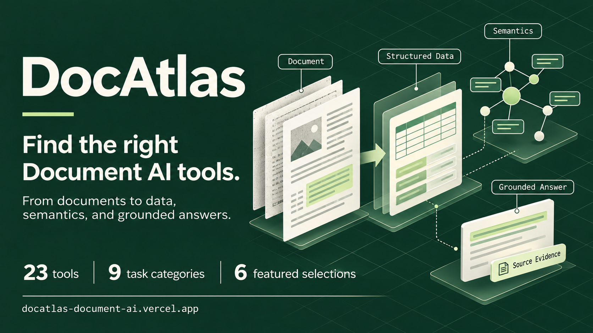
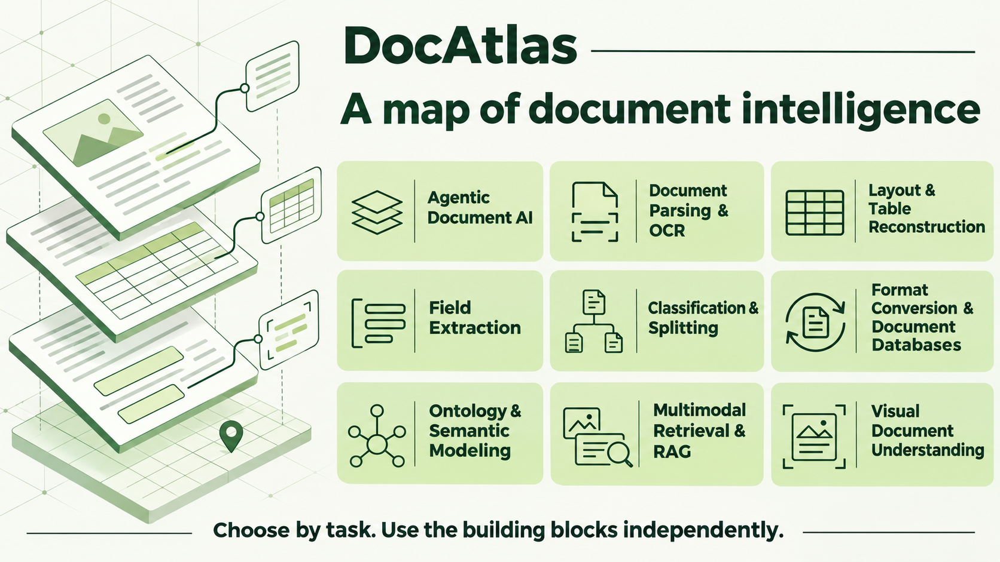

# DocAtlas

### A curated directory of Document AI tools — from documents to data, semantics, and grounded answers.

**[Explore the directory](https://docatlas-document-ai.vercel.app/) · [Featured tools](https://docatlas-document-ai.vercel.app/picks/) · [Selection methodology](https://docatlas-document-ai.vercel.app/methodology/) · [Suggest a tool](https://docatlas-document-ai.vercel.app/submit/)**

Choosing a Document AI stack means navigating OCR libraries, extraction APIs, research systems, and semantic platforms with very different capabilities.

DocAtlas brings them into one task-oriented directory. Compare what each tool accepts, what it produces, how it runs, and what you should verify before adopting it.

## Why DocAtlas?

- **Browse by the job.** Find tools for a specific workflow, from scanned pages to structured records and evidence-grounded answers.
- **Compare practical trade-offs.** Inspect inputs, outputs, deployment, pricing models, and known limitations in a consistent format.
- **Understand the evidence.** Distinguish page citations, bounding boxes, semantic evidence, and database lineage.
- **Read the selection rationale.** Featured tools have a named use case, a reason for inclusion, and limitations to check.
- **Connect documents and semantics.** Explore ontology construction and semantic modeling alongside document parsing, extraction, and retrieval.

## Browse by task

| Task | What it covers |
| --- | --- |
| Agentic Document AI | Multi-step document workflows, evidence checks, and repair |
| Document Parsing & OCR | Text recovery from digital documents and scanned pages |
| Layout & Table Reconstruction | Reading order, page structure, and table cells |
| Field Extraction | Schema-defined fields and structured extraction |
| Classification & Splitting | Document types, page boundaries, and routing |
| Format Conversion & Document Databases | Machine-readable formats, records, and databases |
| Ontology & Semantic Modeling | Concepts, relationships, mappings, constraints, and evolution |
| Multimodal Retrieval & RAG | Visual retrieval, document questions, and cited answers |
| Visual Document Understanding | Page, chart, and visual-content interpretation |

These categories form a navigation map. Tools can support multiple tasks and can be used independently.

## Featured starting points

| Tool | A workflow to evaluate it for |
| --- | --- |
| [Docling](https://docatlas-document-ai.vercel.app/tools/docling/) | Developer document conversion |
| [LandingAI ADE](https://docatlas-document-ai.vercel.app/tools/landingai-ade/) | Source-grounded extraction APIs |
| [Lido](https://docatlas-document-ai.vercel.app/tools/lido/) | Business spreadsheet workflows |
| [Atlas Workspace](https://docatlas-document-ai.vercel.app/tools/atlas-workspace/) | Ready-to-use research Q&A with citations |
| [DataMosaic](https://docatlas-document-ai.vercel.app/tools/datamosaic/) | Document-to-database workflows and cross-page research |
| [EvoOntology](https://docatlas-document-ai.vercel.app/tools/evoontology/) | Evolving semantic layers for data agents |

The directory contains **23 tools across 9 task categories**, with **6 featured selections**, as of November 12, 2026. [Browse all tools →](https://docatlas-document-ai.vercel.app/#directory)

## How we curate

Profiles are based on official project and product documentation. We prioritize clear task fit, inspectable outputs, deployment information, and visible limitations.

Featured selections are **documentation-based editorial recommendations, not a measured accuracy ranking**. Current entries have not been independently benchmarked by DocAtlas. Use your own documents to validate quality, citation fidelity, and operating costs.

## Contribute a tool or correction

Email **[document.ai.tool@gmail.com](mailto:document.ai.tool@gmail.com)** with:

- Name, official URL, and a one-sentence tagline.
- Primary category and the workflow stages it supports.
- Pricing model, deployment options, and licensing.
- A GitHub link if open source.
- Official documentation, a demo or reproducible example, and important limitations.
- A product contact and a link to current pricing.

We welcome corrections and evidence that improves an existing profile. Submissions are reviewed before inclusion; featured placement is not for sale.

## Support the project

If DocAtlas helps you build a better shortlist, consider starring the repository and sharing it with your team. Useful corrections and thoughtful recommendations help the directory grow.

---

**Document AI · OCR · PDF parsing · Structured extraction · Multimodal RAG · Ontology · Semantic modeling · Data agents**
